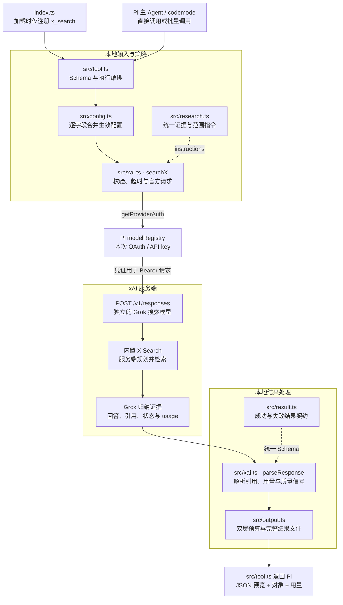
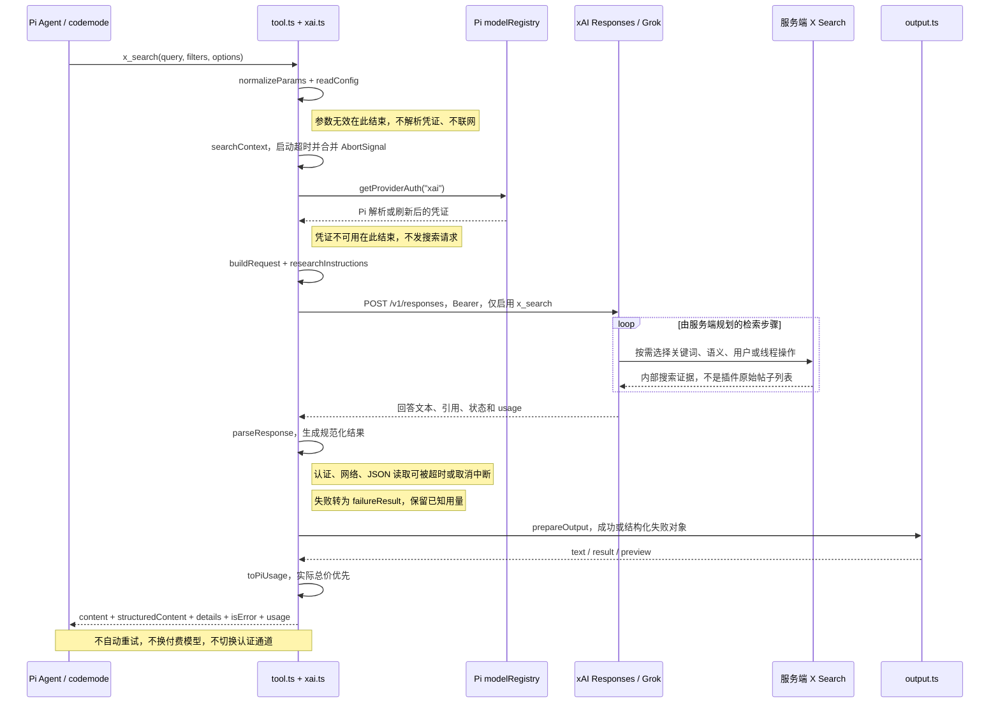
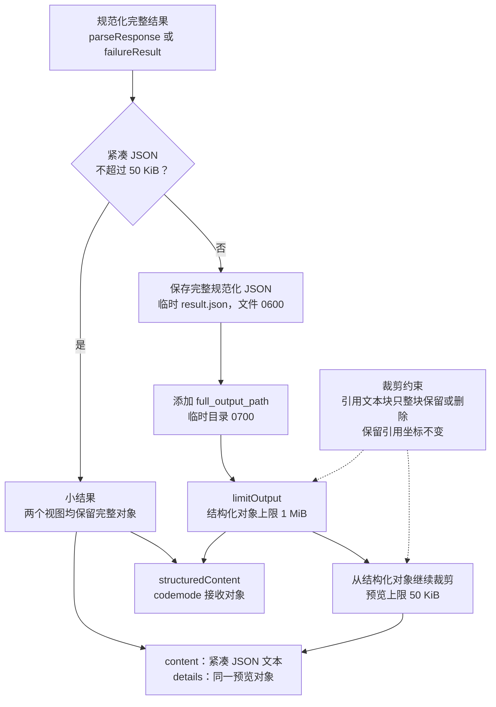

# pi-x-search 工作原理与架构

按仓库当前 **0.4.0** 实现整理，图中箭头表示主要调用或数据流，不是完整的 TypeScript import 依赖图。xAI 内部检索过程是服务端行为，插件没有实现本地 X 爬虫或帖子分页。

## 先建立一个正确的心智模型

**Pi 主 Agent 提出问题 → 插件准备约束并复用 Pi 的 xAI 凭证 → Grok 在 xAI 服务端搜索 X 并归纳 → 插件整理引用、质量信号和用量 → 主 Agent 使用证据继续工作。**

Pi 主模型与 Grok 搜索模型是两件事。主 Agent 可以使用其他供应商；本插件的 `model` 只选择研究用的 Grok。返回的是 Grok 的研究笔记，不是未经模型处理的原始帖子数组。

渲染图使用 **github-light** 主题；源文件为 `docs/diagrams/*.mmd`，SVG/PNG 预览位于同一目录。建议放大 SVG 查看时序图。

## 1. 总体架构

[SVG](diagrams/architecture.svg) · [PNG](diagrams/architecture.png) · [Mermaid 源码](diagrams/architecture.mmd)



### 文件职责

| 文件 | 主要职责 |
| --- | --- |
| `index.ts` | 入口，仅调用 `pi.registerTool(createXSearchTool())`。加载插件不登录、不请求网络。 |
| `src/tool.ts` | 定义输入 Schema、工具说明、并行执行属性；编排配置、认证回调、搜索、输出和 Pi 用量；捕获失败。 |
| `src/config.ts` | 验证七项搜索设置，逐字段合并单次参数、环境变量和模式后备预算；记录 `request_settings`。 |
| `src/research.ts` | 生成基础证据规则、研究策略、操作者偏好、仅帖子限制和候选上限指令。 |
| `src/xai.ts` | 规范化输入、构建官方请求、超时/取消、解析回答/引用/用量、脱敏和 URL 安全检查。 |
| `src/result.ts` | 成功/失败结果的 TypeBox Schema、类型、`SearchError`、来源上下文和 `failureResult()`。 |
| `src/output.ts` | 按序列化 JSON 字节数限制输出，保存完整结果，保护引用文本与坐标。 |
| `scripts/load-session.ts` | 测试用隔离 Pi 会话加载器，可启用真实 codemode 管线；不是生产调用必须经过的入口。 |
| `scripts/smoke.ts` | 可选真实 API 检查，会读取 Pi 凭证并消耗 xAI 额度。 |
| `test/*.test.ts` | 参数、配置、API 异常、引用、输出预算、认证、真实 Pi 加载与 codemode 的测试。 |

`package.json` 声明 Pi 扩展入口为 `./index.ts`，要求 Node >= 22.19.0，当前包内运行文件是入口、`src/` 和 README。本文和图是仓库文档，没有改变运行逻辑。

## 2. 一次调用如何执行

[SVG](diagrams/request-sequence.svg) · [PNG](diagrams/request-sequence.png) · [Mermaid 源码](diagrams/request-sequence.mmd)



时序图展示正常响应的主路径，旁注标出提前结束的位置。参数/认证失败、HTTP 失败、无效 JSON、拒答、超时和取消可以提前结束，统一进入结构化失败处理，不会继续执行后续搜索步骤。

### 2.1 在联网前检查参数

`tool.execute()` 先执行 `normalizeParams()` 和 `readConfig()`，即使绕过工具 Schema 也保留运行时校验。内部 `searchX()` 只接收 `NormalizedSearchParams`，不再重复规范化；直接调用内部传输的代码必须先经过 `normalizeParams()`。

- `query`：必填，trim 后非空，原长度最多 16000 字符。
- `instruction`：可选，最多 8000 字符。
- 账号列表：允许与排除列表互斥，每个列表 1–20 项；去掉单个 @ 前缀、转小写、去重，验证实际账号形状而非 URL。
- 日期：检查真实日历日期和区间顺序，不能仅通过正则就接受 2 月 30 日。
- `posts_only`、图片/视频理解：必须是布尔值。
- 七项模型/预算/研究设置按 Schema 验证；工具输入 Schema 拒绝额外字段，因此调用者不能另传凭证或端点。

Pi 在进入工具前拒绝的 Schema、权限或扩展钩子错误，可能直接 reject；已经进入本插件执行的失败则返回错误对象。这是 codemode 使用 `Promise.allSettled()` 的理由。

### 2.2 配置按字段合并，不是整组覆盖

**单次显式参数 > 对应环境变量默认值 > 所选研究模式预设。**

| 模式 | max_tool_calls | max_output_tokens | max_candidates |
| --- | ---: | ---: | ---: |
| quick | 2 | 2048 | 5 |
| balanced，默认 | 8 | 4096 | 5 |
| deep | 12 | 8192 | 10 |

其他缺省值：`model: grok-4.7`、`timeout_ms: 180000`、`reasoning_effort: model_default`。

例如环境 tokens=8192，调用只传 quick，tokens 仍是 8192；quick 不会把显式环境默认强行改成 2048。调用再传 tokens=2048 才覆盖它。环境变量不是不可覆盖的预算上限；某个被显式调用参数替代的环境默认值不会再参与该字段的验证。

`request_settings` 保存实际选择的设置，不证明服务端严格执行预算；配置或参数无效、尚未完成设置解析时可能省略。操作者指令原文不回显到该元数据。

### 2.3 认证由 Pi 管理，插件只取本次可用凭证

每次调用执行 `ctx.modelRegistry.getProviderAuth("xai")`，不在插件中缓存凭证。

- OAuth 刷新、凭证来源优先级、并发刷新协调与持久化交给 Pi。
- 插件只取得当前可用的 Bearer 凭证和非敏感来源标签：oauth / api_key / unknown。
- 没有可用凭证：`auth_unavailable`；解析或刷新失败：`auth_failed`，均不发送搜索请求。
- 浏览器里登录 grok.com/X 不等于 Pi 已获得 xAI 授权。
- 插件不会在认证失败后自行换另一条认证通道。

集成测试用临时 dummy auth 文件，验证两个并发搜索只有一次 OAuth 刷新，不修改用户真实登录状态。

### 2.4 发给 xAI 的内容

固定端点：`https://api.x.ai/v1/responses`。

请求包含：

- 本次 query 和可选附加 instruction。
- `researchInstructions()` 生成的统一研究指令。
- 一个 `type: x_search` 工具及账号、日期、图片/视频理解配置。
- 所选 model、输出 token 预算、服务端工具调用预算。
- 显式推理档位才添加 `reasoning.effort`；model_default 表示省略该字段，不等于关闭推理。
- `tool_choice: required`、`store: false`、`stream: false`；fetch 禁止跟随重定向。

**不会自动发送当前 Pi 的完整对话历史。** 但 Agent 自己放进 query/instruction 的内容会发送给 xAI。`store: false` 是 Responses 请求设置，不是对供应商所有日志或内部保留行为的绝对保证。

Grok 负责在服务端规划搜索和归纳；一个插件调用可以包含多个内部检索操作。插件通过 Pi `onUpdate` 提供解析凭证、请求 xAI、解析响应三个本地阶段反馈，但没有 Grok 内部检索输出流，也不返回模型的内部推理内容。

### 2.5 不同限制分别约束什么

| 设置 | 实现位置 | 实际含义 |
| --- | --- | --- |
| 账号、日期、媒体理解 | 请求中的原生 x_search 配置 | 交由官方工具处理；插件规范化并验证输入 |
| model | Responses 顶层 | 搜索研究模型，不是 Pi 主模型 |
| max_output_tokens | Responses 顶层 | 输出预算，包含推理；不是候选或帖子数量 |
| max_tool_calls | Responses 顶层 + 指令 | 下发的服务端调用预算；不等于抓取帖数，严格计费上限未独立验证 |
| max_candidates | 研究指令 | 提示词软上限；没有 candidates[] 或本地硬条数校验 |
| research_mode | 配置后备预算 + 指令 | 搜索策略；不设置 reasoning.effort |
| reasoning_effort | Responses reasoning.effort | 推理深度；不设置帖子数或搜索调用数 |
| timeout_ms | 本地 searchX | 认证解析、HTTP 请求、JSON 读取的超时；不覆盖后续文件保存 |
| posts_only | 查询操作符 + 研究指令 | best-effort 排除回复；不是官方原生帖类型过滤 |

`posts_only: true` 会为传给 Grok 的查询补充 `-filter:replies`（已有独立操作符则不重复），要求每个关键词搜索变体都排除回复，不用语义搜索或线程抓取绕过限制，不以回复补足数量。作者自回复也排除，引用帖/转帖不额外排除。

插件不向 API 虚构 posts_only / exclude_replies 字段，也不从 URL 推断帖类型；成功结果始终带 `posts_only_unverified` 警告。换更强模型不会把它变成独立核验的硬过滤。

这些设置都**不限制主 Agent 在整个任务里调用 x_search 的总次数**。

### 2.6 超时、取消和错误

`searchX()` 合并调用方信号与本地超时信号，并通过 `Promise.race()` 包装认证、fetch 和流式响应读取。响应体先检查 Content-Length，再按实际字节限量至 16 MiB；缓冲区按需扩容并合并碎片，避免小分块的元数据无界累积。超限、超时或取消会停止读取并尝试取消响应流。即便某个实现忽略 AbortSignal，本地调用也能停止等待；这不能保证已经开始的远端工作不计费。

插件不会自动重试，不会偷偷换模型。`retryable: true` 仅表示 Agent 可以考虑有意识地重试。

典型失败码：invalid_arguments、invalid_config、auth_unavailable、auth_failed、http_error、network_error、invalid_response、refused、empty_response、timeout、cancelled、internal_error。

HTTP 提示区分：

- 401：凭证需要更新。
- 403：检查订阅/模型/工具权益，重新登录未必能解决。
- 402/429：余额、额度或限流。
- 429/5xx：可考虑重试，但插件不代替调用方重复付费。429 的有效 Retry-After 秒数/HTTP 日期会转换为等待秒数提示，即使响应不是 JSON 也保留。

失败是 `success: false`、`status: error`、`error: {code,message,retryable,http_status?}`，没有 answer，Pi 标记 isError=true。意外异常使用通用错误文本，不回显原始异常、请求头或供应商原始响应。可通过 PI_X_SEARCH_DEBUG=1 开启 stderr 诊断，仅输出白名单错误类别/文件系统错误码和本插件源码行列，不输出原始 message/cause 或绝对路径。已知已产生的用量会尽量保留，未知用量不会凭空推算。

## 3. 引用为何分四个通道

`parseResponse()` 将供应商输出规范化，不把所有 URL 混成一个 sources 列表：

| 字段 | 含义 |
| --- | --- |
| citations | API 顶层引用 URL 列表，去重 |
| inline_citations | 行内引用及原始坐标；按 URL、text_index、start_index、end_index 去重，保留不同位置/文本块的引用 |
| citation_texts | 有行内引用的供应商原始文本块，坐标锚点 |
| search_sources | 检索来源，可能没有在回答中引用 |

例如：

```json
{
  "citation_texts": ["Grok 的某项更新已经发布。"],
  "inline_citations": [{
    "url": "https://x.com/xai/status/123",
    "text_index": 0,
    "start_index": 0,
    "end_index": 4
  }]
}
```

这只是形状示例，URL/坐标不表示真实检索证据。

坐标指向 `citation_texts[0]`，**不是合并后的 answer**。缺失/无效坐标为 null；不要假定供应商的 Unicode 索引单位，也不要随意重新映射坐标。

answer 会去掉部分控制字符并拼接；引用锚点文本保留原字符序列，只有已知凭证回显采用等长掩码，以避免移动引用坐标。URL 只接受 HTTP/HTTPS，拒绝含用户名/密码的 URL。

`citation_count` 是完整结果顶层+行内引用的唯一 URL 数，不包括 search_sources，也不会因为视图裁剪而重算。

质量信号：

- 没有任何回答引用：uncited_answer。
- 供应商返回 incomplete：incomplete_response，并保留 incomplete_reason。
- 启用账号/日期/posts_only 筛选但没有回答引用：degraded=true、no_citations_with_filters。
- 启用 posts_only：posts_only_unverified。

**success 代表获得了可解析的研究结果，不代表事实经过独立验证；degraded=false 也不代表不存在幻觉。** 没有引用不能证明 X 上没有匹配帖子，检索来源本身也不能证明回答中的断言有引用支持。

## 4. 双层输出预算

[SVG](diagrams/output-budgets.svg) · [PNG](diagrams/output-budgets.png) · [Mermaid 源码](diagrams/output-budgets.mmd)



### 为什么不是只有一个 50 KiB 上限？

主模型不应每次看到所有证据，但 codemode 可以先拿到较大的对象，在脚本中去重、筛选和投影。

| Pi 返回字段 | 内容 |
| --- | --- |
| content | 模型可见的紧凑 JSON 文本，最多 50 KiB |
| details | 与 content 对应的预览对象 |
| structuredContent | codemode 所接收的结果对象，最多 1 MiB |
| isError | 由结果 success 是否为 false 决定 |
| usage | 转成 Pi 的 token/成本格式，用于用量核算 |

预算检查按 **JSON 序列化后的 UTF-8 字节数**，包含引号、转义和元数据，不是源文本行数或字数。

小结果两个视图相同；超过 50 KiB，先把完整规范化结果保存到临时文件，再生成 1 MiB 结构化视图，最后从这个视图继续生成 50 KiB 预览。所以两种视图的 truncated / truncated_fields 可能不同。

### 如何避免截断破坏引用？

`limitOutput()` 每轮选择可裁字段中序列化体积最大的字段，将字符串/数组约减半：

- query / answer 缩短时不留下半个 UTF-16 代理对。
- 普通引用列表或来源列表可以减少条目。
- citation_texts 只删除尾部整块，并删除对应的 inline_citations。
- 保留引用文本块的坐标不重写；不会截掉半块文本再保留错误坐标。
- citation_count / degraded 仍描述完整响应，不能只按预览中的条目解释。

临时目录由 mkdtemp 创建（0700），result.json 为 0600，直接写入唯一的新文件，无需共享文件变更队列；写入失败时尝试删除新目录。文件内容是规范化完整对象，不是原始 API 响应，也不含额外回显的凭证。工具执行时后台清理修改时间超过 24 小时的本用户 pi-x-search-* 目录，最多每小时一次；跳过符号链接和普通文件，清理失败不影响搜索。需要长期保留时应复制文件。codemode 不能直接访问文件系统，需通过允许的工具或本地脚本读取 full_output_path。

若完整结果写文件失败，工具会转换为结构化失败；如果失败对象的输出准备也出错，使用仅内存的有界错误预览作为兜底。

## 5. 用量与成本如何核算

`parseUsage()` 提取 input/output/cache/reasoning/total tokens，以及供应商报告的：

- x_search_calls：搜索调用计数。
- x_posts_fetched：帖子抓取计数。
- x_users_fetched：用户资料抓取计数。
- cost_usd：cost_in_usd_ticks / 10,000,000,000。

供应商报告的实际总成本优先；未提供实际总价时，`toPiUsage()` 尝试用 Pi 模型价格估算 token 成本，**该估算不补算未知检索费用**。供给结果的 model 优先采用供应商实际返回的模型名，request_settings.model 保留请求的模型/别名。

token 值被规范化为非负数；cached input 不超过 input，Pi 的 input 不重复计入 cacheRead。推理 token 是输出的一部分，不能再次叠加到总价或总 token。

实际 Pi codemode 集成测试验证了子工具用量通过会话事件核算，父 codemode 不重复计费。最终候选数量和 citation_count 不是抓取计数，也不是费用指标。

## 6. 阅读与验证路线

建议顺序：

1. `index.ts` → `src/tool.ts`：看入口和整条编排。
2. `src/config.ts` + `src/research.ts`：看配置如何变成请求策略。
3. `src/xai.ts` 的 normalizeParams / buildRequest / searchX / parseResponse：看验证、网络与归一化。
4. `src/result.ts`：理解成功、错误、引用与质量契约。
5. `src/output.ts`：理解双层输出与引用安全裁剪。
6. `test/pi-loader.test.ts`、`test/posts-only.test.ts`、`test/output.test.ts`：核对真实管线与关键边界。

`npm run check` 执行类型检查；`npm test` 使用 mock API/临时凭证测试，不产生真实搜索费。`npm run smoke` 是单独 opt-in 的收费真实调用。

### 本地重绘

使用现有 pretty-mermaid skill，不需要向项目添加运行依赖：

```bash
node /Users/hwj/.pi/agent/skills/pretty-mermaid/scripts/batch.mjs \
  --input-dir docs/diagrams --output-dir docs/diagrams \
  --format svg --theme github-light --font "PingFang SC"

node /Users/hwj/.pi/agent/skills/pretty-mermaid/scripts/batch.mjs \
  --input-dir docs/diagrams --output-dir docs/diagrams \
  --format png --width 1800 --theme github-light --font "PingFang SC"
```
